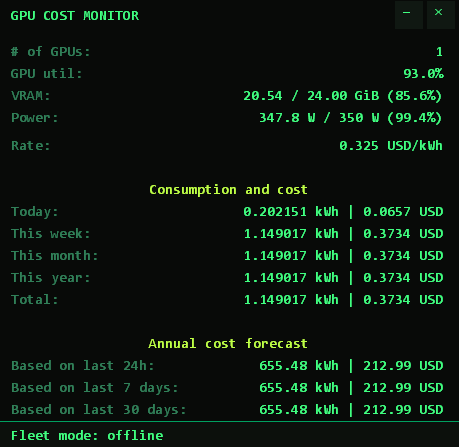

# GPU Cost Monitor

A native Windows x64 desktop application (C++17, Win32 API) that monitors
GPU utilization, VRAM, and power draw in real time and tracks the
electricity cost of GPU usage of a single or multiple machines.

## Screenshots

### Main Window


### Settings


## Features

- **NVIDIA** support via NVML (`nvml.dll`)
- **AMD** support via ADLX (`atio6axx.dll` / `amdxx.dll` / `adlx.dll`)
- Vendor driver DLLs are **optional runtime dependencies** loaded dynamically.
  Missing DLLs or GPUs never prevent startup; unavailable telemetry is shown
  as `N/A`.
- Custom-chrome UI: near-black background, neon-green monospaced text,
  draggable (fixed-size) window, live 1-second chart with 5-minute rolling
  history, and a stats panel (VRAM, power, live costs, period costs).
- Energy and costs are computed from measured power and elapsed time
  (trapezoidal integration). Downtime (no power reading) is never counted.
- Historical costs are stamped with the electricity rate in effect when the
  energy was consumed.
- Live projections: cost per hour/year from current power, plus annual
  projections based on the last 24h / 7d / 30d of history.
- Optional local REST API (127.0.0.1 only) with optional password auth.
- Optional **fleet monitoring**: a "server" machine aggregates per-second
  GPU stats streamed from one or more "client" machines.
- Dependency-free Excel export (real XLSX; falls back to CSV).
- Optional: launch at startup (registry Run key), always-on-top window,
  graph on/off.

## User interface

- **Right-click** opens the menu:
  - **Settings...** — electricity rate, currency, REST API enable/port/
    password, fleet monitoring (server/client), launch at startup,
    always on top, show graph, reset cost records
  - **Export to Excel** — writes `data\gpu_cost_export.xlsx` (a real XLSX;
    falls back to CSV if XLSX writing fails)
  - **About** — shows version, copyright, and donation info
  - **Exit**
  - **—** minimizes, **✕** hides.
  - App lives in system tray.

## Configuration

`config.json` (created on first settings save):

```json
{
  "electricity_rate": 0.100,
  "currency": "USD",
  "api_enabled": false,
  "api_port": 18744,
  "api_password": "",
  "cloud_enabled": false,
  "net_mode": "server",
  "net_ip": "127.0.0.1",
  "net_port": 18743,
  "cloud_password": "password",
  "launch_at_startup": false,
  "always_on_top": false,
  "show_graph": false
}
```

| Field | Meaning |
|---|---|
| `electricity_rate` | cost per kWh (3 decimal places) |
| `currency` | currency code shown in the UI and API |
| `api_enabled` | start the REST API on launch |
| `api_port` | REST API port (default 18744) |
| `api_password` | REST API password (`""` = no authentication) |
| `cloud_enabled` | enable fleet monitoring (server or client mode) |
| `net_mode` | `"server"` or `"client"` |
| `net_ip` | server: clients connect here; client: server address |
| `net_port` | fleet monitoring port (default 18743) |
| `cloud_password` | shared secret for fleet monitoring (default `"password"`) |
| `launch_at_startup` | register in the Windows Run key |
| `always_on_top` | keep the main window above all other windows |
| `show_graph` | show the live graph (off by default → stats only) |

## REST API

Enable in Settings (or set `api_enabled: true` in `config.json`). Binds to
`127.0.0.1` only (loopback; not reachable from other machines). Connections
are handled sequentially; all responses are JSON with
`Content-Type: application/json`.

### Authentication

Every request may carry a `password` parameter:

- **GET** requests: query parameter `?password=<password>`
- **POST** requests: JSON body field `"password": "<password>"`

When a password is configured (Settings → "API password"), requests with a
missing or mismatching password are rejected with **401**. When no password
is configured, requests are accepted without authentication. Password
changes in Settings apply live (read per request).

### Endpoints

#### `GET /gcm_live_stats`

Current live stats (JSON object).

Response `200`:

```json
{
  "gpu_count": 1,
  "gpu_names": "NVIDIA GeForce RTX 4090",
  "utilization": 45.0,
  "vram_used_bytes": 1073741824,
  "vram_total_bytes": 25769803776,
  "power_w": 250.0,
  "power_limit_w": 450.0,
  "cost_today": 0.05,
  "energy_today": 0.5,
  "cost_this_week": 0.3,
  "energy_this_week": 3.0,
  "cost_this_month": 1.2,
  "energy_this_month": 12.0,
  "cost_this_year": 10.0,
  "energy_this_year": 100.0,
  "cost_total": 10.0,
  "energy_total": 100.0,
  "minute_energy_kwh": 0.001,
  "minute_cost": 0.0001,
  "energy_fcst_base_24h": 120.0,
  "cost_fcst_base_24h": 12.0,
  "energy_fcst_base_7d": 110.0,
  "cost_fcst_base_7d": 11.0,
  "energy_fcst_base_30d": 105.0,
  "cost_fcst_base_30d": 10.5,
  "rate_per_kwh": 0.1,
  "currency": "USD"
}
```

Field notes:

- `utilization` / `vram_*` / `power_w` / `power_limit_w` are `null` when
  the telemetry is unavailable.
- `cost_*` / `energy_*` = persisted history + current live minute.
- `energy_fcst_base_*` / `cost_fcst_base_*` = annual projections based on
  the last 24h / 7d / 30d of history.

#### `GET /gcm_hourly_stats`

Hourly records with `start_unix <= timestamp < end_unix`.

Query parameters:

| Parameter | Required | Meaning |
|---|---|---|
| `start_unix` | yes | window start, unix seconds |
| `end_unix` | no | window end, unix seconds; defaults to "now" when omitted or 0 |
| `client` | no | source-IP filter, e.g. `192.168.1.50`. When omitted, records of all source IPs are aggregated per timestamp and `client` is `"aggregated"` |
| `password` | no | see Authentication |

Response `200`:

```json
{
  "client": "aggregated",
  "data": [
    {
      "timestamp": 1700000000,
      "gpu_count": 2,
      "gpu_usage_percent": 61.5,
      "vram_usage_percent": 42.0,
      "energy_kwh": 0.123,
      "electricity_rate": 0.1,
      "cost": 0.0123
    }
  ]
}
```

#### `POST /gcm_rate`

Update the electricity rate (and optionally the currency). The new rate is
applied to all live accumulators and persisted to `config.json`.

Request body (JSON):

```json
{ "rate": 0.15, "currency": "EUR", "password": "<password>" }
```

- `rate` (required) — non-negative number, cost per kWh
- `currency` (optional) — currency code; omitted/empty keeps the current one
- `password` (optional) — see Authentication

Response `200`:

```json
{ "ok": true, "rate": 0.150000 }
```

Errors:

- `400` `{"error":"missing or invalid 'rate'"}`
- `400` `{"error":"rate update failed"}`

#### Error responses (all endpoints)

| Status | Body |
|---|---|
| `400` | `{"error":"..."}` — bad request (e.g. invalid rate) |
| `401` | `{"error":"invalid or missing password"}` |
| `404` | `{"error":"not found"}` — unknown path or method |

### Examples

```bat
curl "http://127.0.0.1:18744/gcm_live_stats"
curl "http://127.0.0.1:18744/gcm_hourly_stats?start_unix=0&end_unix=9999999999"
curl "http://127.0.0.1:18744/gcm_hourly_stats?start_unix=0&end_unix=9999999999&client=192.168.1.50"
curl -X POST http://127.0.0.1:18744/gcm_rate -d "{\"rate\":0.15,\"currency\":\"EUR\"}"
```

With a password:

```bat
curl "http://127.0.0.1:18744/gcm_live_stats?password=secret"
curl -X POST http://127.0.0.1:18744/gcm_rate -d "{\"rate\":0.15,\"password\":\"secret\"}"
```

## Fleet monitoring

Enable in Settings ("Enable fleet monitoring"). A small line-based TCP
protocol lets a "client" machine stream its GPU stats to a "server" machine
once per second. The server aggregates the data from all connected clients
(summing power / energy / GPU counts) so it can display and persist
cumulative values across the whole fleet.

- **Server mode**: listens on `0.0.0.0:<net_port>` (default 18743).
- **Client mode**: connects to `<net_ip>:<net_port>`, reconnects
  automatically if the connection drops.

Protocol (line-based, `\n`-terminated, ASCII):

```
client -> server : "AUTH <password>\n"
server -> client : "OK\n"   (password matched)  or  "ERR\n"
client -> server : "DATA <gpu_count> <gpu_usage> <vram_used> <vram_total> <power_w>\n"
                   (sent once per second while connected)
```

The password is the shared secret from the config (`cloud_password`,
default `"password"`). A client is only accepted if the password it sends
matches the server's password. Fleet data is persisted with the client's IP
in the `ip_address` column of the CSV files, and can be queried per client
via the REST API `client` parameter.


## Contact

fettschuerzen.chad@pm.me
